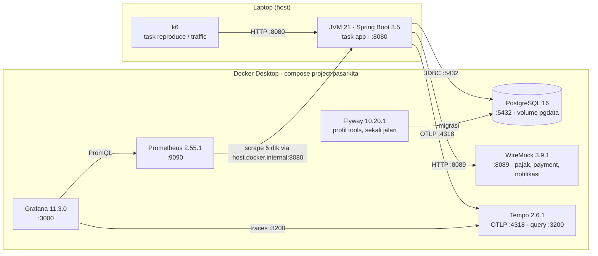

# PasarKita – base code minggu 1

Aplikasi modulith Spring Boot untuk lab backend. Versi ini disiapkan untuk minggu 1
(orientasi dan alat ukur). Masalah untuk lab minggu 2–6 ditambahkan bertahap.

## Prasyarat

JDK 21, Docker Desktop (backend WSL2 di Windows), Git, k6, dan Task (go-task).
Di Windows:

```powershell
winget install EclipseAdoptium.Temurin.21.JDK
winget install Git.Git
winget install Task.Task
```

Docker Desktop dan k6 dipasang dari installer resmi masing-masing.

## Mulai cepat

```powershell
task doctor                          # periksa lingkungan
task up PROFILE=core,observability   # PostgreSQL, Prometheus, Grafana, Tempo, WireMock
task seed SCALE=S                    # migrasi skema + data contoh (skala M untuk Lab 0)
task app                             # aplikasi di http://localhost:8080
task test                            # test fungsional (butuh Docker untuk Testcontainers)
```

Ketik `task --list` untuk semua perintah.

Tidak bisa memakai Docker (misalnya macOS 12)? Lihat [`infra/native/README.md`](infra/native/README.md)
untuk menjalankan semua komponen pendukung tanpa Docker (`task native:up`).

Baru di proyek ini? Mulai dari [`docs/MATERI-DASAR.md`](docs/MATERI-DASAR.md): daftar isi
dan jalur belajar untuk tujuh bagian materi (fondasi, lingkungan kerja, memahami sistem,
mengukur, mutu dan desain, diagnosa dan latihan, menyerahkan hasil) beserta referensi.

| Alamat | Isi |
| --- | --- |
| http://localhost:8080/actuator/health | Status aplikasi |
| http://localhost:3000 | Grafana, dashboard "PasarKita Overview" di folder PasarKita |
| http://localhost:9090 | Prometheus |
| http://localhost:8089 | WireMock: API pajak, payment gateway, dan notifikasi tiruan |

Akun contoh: `user1@pasarkita.test` sampai `userN@pasarkita.test`, password `rahasia123`.
Endpoint keranjang dan checkout memakai header `X-Customer-Id`.

## Modul

catalog, customer, order, pricing, inventory, payment, invoice, loyalty, notification,
shipping, booking, reporting, jobs, files, audit. Lihat `task modules` untuk verifikasi
struktur dan dokumentasi yang dihasilkan Spring Modulith.

## Deployment

Diagram lengkap, tabel port, dan varian tanpa Docker ada di [`docs/DEPLOYMENT.md`](docs/DEPLOYMENT.md).
Semua komponen berjalan di satu laptop. Aplikasi dan k6 berjalan langsung di host,
infrastruktur pendukung berjalan di Docker Compose.



Profil compose: `core` (PostgreSQL, WireMock, Prometheus, Grafana), `observability` (Tempo),
`tools` (Flyway). Aplikasi tidak dikemas dalam container: Prometheus menariknya lewat
`host.docker.internal`. Satu WireMock menggantikan tiga layanan luar, dibedakan oleh path.
Data bertahan di volume `pgdata` sampai `task reset`.

## Teknologi dan alat

**Library aplikasi** (Spring Boot 3.5.0, Spring Modulith 1.4.0)

| Kelompok | Library |
| --- | --- |
| Web dan data | `spring-boot-starter-web`, `-data-jpa`, `-validation`, PostgreSQL JDBC |
| Keamanan | `spring-security-crypto` (BCrypt) |
| Migrasi | `flyway-core`, `flyway-database-postgresql` |
| Modul | `spring-modulith-starter-core`, `spring-modulith-observability` |
| Observability | `spring-boot-starter-actuator`, `micrometer-registry-prometheus`, `micrometer-tracing-bridge-otel`, `opentelemetry-exporter-otlp` |
| Test | `spring-boot-starter-test`, Testcontainers (`junit-jupiter`, `postgresql`), `spring-modulith-starter-test`, `spring-modulith-docs` |

**Infrastruktur (image Docker):** `postgres:16`, `flyway/flyway:10.20.1`,
`wiremock/wiremock:3.9.1`, `prom/prometheus:v2.55.1`, `grafana/grafana:11.3.0`,
`grafana/tempo:2.6.1`.

**Alat di mesin pengembang:** JDK 21, Docker Desktop, Task (go-task), k6, Git, dan Maven
Wrapper. Skrip bantu `tools/Doctor.java` (cek lingkungan) dan `tools/Evidence.java`
(file bukti dengan hash SHA-256) dijalankan langsung oleh JDK.

## Uji beban dengan k6

| Script | Tujuan | Laju |
| --- | --- | --- |
| `labs/0/reproduce.k6.js` | Baseline 8 endpoint (Lab 0) | 31 iterasi/detik, 3 menit |
| `labs/latihan/profile.k6.js` | Beban ke halaman profil penjual | 5 req/detik, 3 menit |
| `traffic/simulator.k6.js` | Traffic latar belakang | 7 iterasi/detik, 8 jam |

Semuanya memakai model terbuka (`constant-arrival-rate`), jadi laju request tetap walau
server melambat. Status 402 dan 409 pada checkout dianggap normal. Lihat `labs/0/LAB.md`
untuk catatan penggunaan.

## Catatan Windows

- Simpan repo di path pendek, misalnya `C:\dev\pasarkita`, dan jalankan
  `git config --global core.longpaths true`.
- Memori Docker diatur lewat `%UserProfile%\.wslconfig`, lalu `wsl --shutdown`.
- Gunakan `curl.exe`, bukan `curl`, di Windows PowerShell 5.1.
- Kecualikan folder repo dan `%UserProfile%\.m2` dari pemindaian Microsoft Defender.
