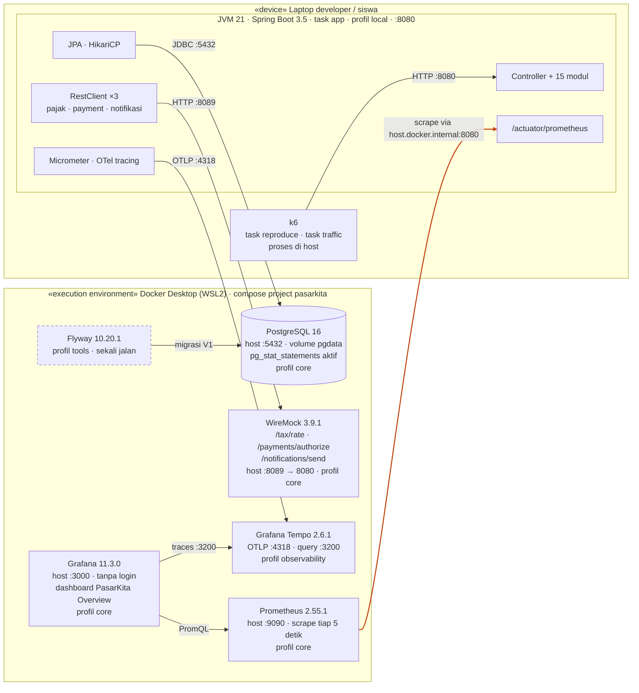

# Deployment PasarKita

Semua komponen lab berjalan di satu laptop: aplikasi dan k6 langsung di host, infrastruktur
pendukung di Docker Compose.

## Diagram



**Cara membaca.** Panah menunjukkan siapa yang memulai koneksi. Panah oranye adalah satu-satunya
koneksi yang keluar dari Docker ke host: Prometheus di container menarik metrik dari aplikasi
yang berjalan di luar Docker. Kotak Flyway bergaris putus-putus karena container sementara
yang berhenti setelah selesai.

## Alamat dan port

| Komponen | Berjalan di | Port host | Profil compose |
| --- | --- | --- | --- |
| Aplikasi PasarKita | Host (JVM) | 8080 | - |
| k6 | Host | - | - |
| PostgreSQL 16 | Docker | 5432 | `core` |
| WireMock | Docker | 8089 | `core` |
| Prometheus | Docker | 9090 | `core` |
| Grafana | Docker | 3000 | `core` |
| Tempo | Docker | 4318, 3200 | `observability` |
| Flyway | Docker (sementara) | - | `tools` |

## Yang perlu diperhatikan

- **Aplikasi tidak dikemas dalam container.** `task app` menjalankan Maven langsung di host,
  jadi aplikasi memanggil layanan Docker lewat `localhost`, sedangkan Prometheus memanggil
  balik lewat `host.docker.internal`.
- **Satu WireMock menggantikan tiga layanan luar.** API pajak, payment gateway, dan notifikasi
  semuanya menuju `:8089`, dibedakan oleh path. Latensinya tidak mewakili layanan sungguhan.
- **Data bertahan di volume `pgdata`.** `task down` tidak menghapusnya; `task reset`
  menghapus semuanya.
- **Ini lingkungan lab, bukan produksi.** Tidak ada replika, load balancer, atau pemisahan
  jaringan, dan Grafana berjalan tanpa login.

## Variasi tanpa Docker

Untuk komputer yang tidak bisa menjalankan Docker Desktop (`task native:up`, lihat
`infra/native/README.md`), bagian kanan diagram menjadi proses biasa di host yang sama.
Bedanya:

| Aspek | Dengan Docker | Tanpa Docker |
| --- | --- | --- |
| Lokasi komponen pendukung | Container | Proses di host (`~/pasarkita-native`) |
| Prometheus menarik | `host.docker.internal:8080` | `localhost:8080` |
| Penyimpanan data | Volume `pgdata` | `~/pasarkita-native/data` |
| Flyway | Container (`task migrate`) | CLI (`task native:seed` memigrasi dulu) |
| Test dengan Testcontainers | Bisa | Tidak bisa |

Port dan perilaku yang dilihat aplikasi dan k6 sama.

## Memeriksa bahwa deployment sehat

Ikuti peta lapisan di bagian 6.1.3 (`docs/materi/06-diagnosa-dan-latihan.md`). Ringkasnya:

```bash
docker ps --format "table {{.Names}}\t{{.Status}}"          # container sehat (tanpa Docker: task native:status)
curl http://localhost:8080/actuator/health                  # aplikasi UP
curl "http://localhost:8089/tax/rate?productId=1"           # WireMock menjawab
# http://localhost:9090/targets                              # target pasarkita berstatus UP
```
