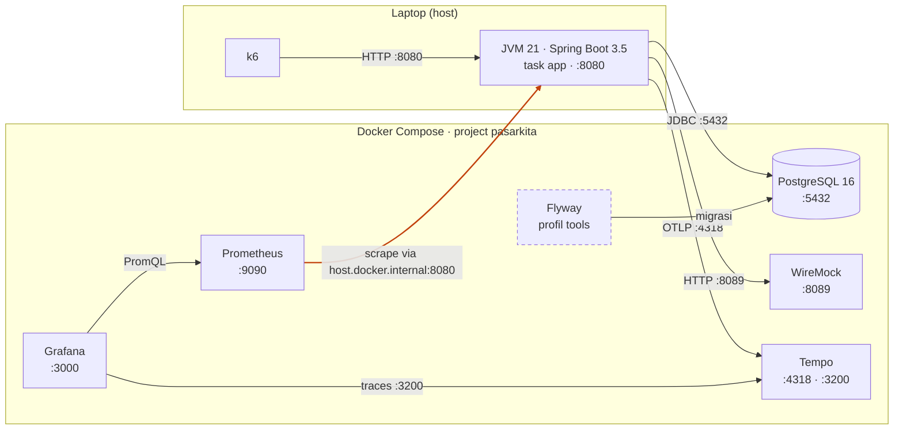

# Bagian 2: Lingkungan kerja

*Memasang, menjalankan, memperbaiki*

> **Tujuan.** Menyiapkan laptop agar seluruh stack dan aplikasi berjalan, lengkap dengan cara memeriksanya.  
> **Prasyarat.** Hak untuk memasang aplikasi dan koneksi internet. Bagian 1.1 boleh dibaca sambil menunggu unduhan.  
> **Setelah bagian ini kamu bisa:**
> - memeriksa alat dengan `task doctor` dan memasang yang kurang
> - menjalankan Maven lewat Maven Wrapper
> - menjelaskan diagram deployment dan memilih Docker atau jalur tanpa Docker
> - menjalankan infrastruktur, mengisi data, dan menyalakan aplikasi dari nol

---

## 2.1 Prasyarat

| Alat | Cek | Hasil yang diharapkan |
| --- | --- | --- |
| JDK 21 | `java -version` | versi 21 (disarankan). `task doctor` juga menerima versi lebih baru; kalau memakainya, catat versinya di `BASELINE.md` dan baca 2.7 |
| Docker Desktop | `docker --version`, `docker compose version` | terpasang dan **sedang berjalan** (versi terbaru di macOS butuh macOS 14 atau lebih baru; di macOS lama pakai komputer lain atau perbarui sistem operasi) |
| Git | `git --version` | terpasang |
| k6 | `k6 version` | terpasang |
| Task | `task --version` | terpasang |

Jalankan `task doctor`; ia memeriksa semuanya, memori Docker, dan port yang dipakai.

---

## 2.2 Maven dan Maven Wrapper

**Maven** adalah alat build untuk Java. `pom.xml` menyatakan proyek, library yang
dibutuhkan, dan plugin. Maven mengunduh library dari repositori (Maven Central) ke cache
lokal `~/.m2/repository` (Windows: `%UserProfile%\.m2`), lalu mengompilasi, menguji, dan
mengemas aplikasi dalam tahap berurutan:

```text
validate → compile → test → package → verify
```

Menjalankan `test` berarti semua tahap sampai `test` ikut dijalankan.

**Maven Wrapper** terdiri dari skrip `mvnw` (macOS/Linux), `mvnw.cmd` (Windows), dan folder
`.mvn/wrapper/` yang menyatakan versi Maven yang dipakai. Saat pertama dijalankan, skrip
mengunduh Maven versi itu ke `~/.m2/wrapper`. Manfaatnya: semua orang memakai versi Maven
yang sama tanpa memasang Maven sendiri. JDK 21 tetap diperlukan.

`Taskfile.yml` memilih `./mvnw` atau `./mvnw.cmd` sesuai sistem operasi. Perintah
`task app`, `task test`, `task modules`, dan `task warmup` semuanya melewatinya.

**Memeriksa**

```bash
ls mvnw*        # Windows: dir mvnw*
./mvnw -v       # Windows: .\mvnw.cmd -v
```

`-v` harus menampilkan versi Maven dan versi Java 21. Eksekusi pertama membutuhkan internet.

**Jika `mvnw` tidak ada di repo** (base code ini sudah menyertakannya, dibuat dengan perintah
berikut dan bertipe `only-script`, jadi tanpa file `.jar`), siapkan dengan Maven yang
terpasang, sekali saja, oleh pengajar atau satu anggota kelompok:

```bash
mvn wrapper:wrapper -Dmaven=3.9.9
```

Versi Maven di atas hanyalah contoh; pilih versi stabil yang disepakati (Spring Boot 3.5
membutuhkan Maven 3.6.3 atau lebih baru). Hasilnya `mvnw`, `mvnw.cmd`, dan
`.mvn/wrapper/`. Commit ketiganya. Di macOS/Linux/Git pastikan skrip dapat dieksekusi:

```bash
git update-index --chmod=+x mvnw
```

`.gitattributes` sudah menjaga akhir baris: `mvnw` memakai LF dan `mvnw.cmd` memakai CRLF.

**Perintah yang berguna** (di Windows ganti `./mvnw` dengan `.\mvnw.cmd`)

| Perintah | Fungsi |
| --- | --- |
| `./mvnw -v` | Versi Maven dan Java yang dipakai |
| `./mvnw test` | Jalankan test (butuh Docker untuk Testcontainers) |
| `./mvnw test -Dtest=SmokeTests` | Jalankan satu kelas test |
| `./mvnw -DskipTests package` | Kemas aplikasi tanpa test |
| `./mvnw dependency:tree` | Lihat pohon dependensi |
| `./mvnw -U test` | Paksa memeriksa ulang pembaruan dependensi |
| `./mvnw -o test` | Mode offline, memakai cache `.m2` saja |
| `./mvnw -X test` | Log sangat rinci untuk diagnosa |

**Masalah umum**

| Pesan atau gejala | Penyebab | Tindakan |
| --- | --- | --- |
| `Permission denied: ./mvnw` | Skrip belum dapat dieksekusi | `chmod +x mvnw` |
| `/bin/sh^M: bad interpreter` atau `\r: command not found` | Akhir baris CRLF pada skrip shell | Periksa `.gitattributes`; checkout ulang file dengan LF |
| `JAVA_HOME ... not defined correctly` | `JAVA_HOME` salah atau kosong | Arahkan ke folder JDK 21 |
| `release version 21 not supported`, `invalid target release: 21` | JDK lebih lama dari 21 | `java -version` dan `javac -version`, perbarui |
| Unduhan macet atau `Could not transfer artifact` | Jaringan, DNS, atau proxy | Tes `curl -I https://repo.maven.apache.org/maven2/`; atur proxy di `~/.m2/settings.xml` |
| `Could not resolve dependencies` setelah unduhan gagal | Cache `.m2` rusak sebagian | Hapus folder artefak itu di `~/.m2/repository`, lalu `./mvnw -U ...` |
| Build sangat lambat (Windows) | Antivirus memindai `.m2` | Kecualikan `%UserProfile%\.m2` dari Defender |

Masalah Maven masuk **lapisan 1** pada peta di bagian 6.1.3.

---

## 2.3 Docker dan Compose

- **Image** adalah paket program siap jalan; **container** adalah image yang sedang
  berjalan. **Volume** menyimpan data di luar container supaya tidak hilang saat container
  dimatikan (`pgdata` untuk database).
- **Docker Compose** menjalankan banyak container sekaligus dari `infra/compose/compose.yaml`.
- **Profil** memilih sebagian layanan: `core` (PostgreSQL, WireMock, Prometheus, Grafana),
  `observability` (Tempo), `tools` (Flyway).
- **Port mapping** `5432:5432` berarti port 5432 di laptopmu diteruskan ke port 5432 di
  container. WireMock berbeda: `8089:8080` (di luar 8089, di dalam 8080).
- **Aplikasi tidak berjalan di container.** Container memanggil aplikasi di laptop lewat
  nama `host.docker.internal` (itu cara Prometheus menarik metrik). Aplikasi memanggil
  container lewat `localhost`.
- **Memori.** Seluruh stack butuh memori cukup. Di Windows, atur lewat `%UserProfile%\.wslconfig`
  lalu `wsl --shutdown`. `task doctor` memeriksanya.
- **Keamanan konfigurasi.** Stack lab sengaja longgar: Grafana tanpa login, kata sandi
  database sederhana, dan port terbuka ke host. Jangan memakai pola ini di server yang bisa
  diakses orang lain (OWASP A05). Image memakai tag versi tetap (misalnya
  `grafana/grafana:11.3.0`), bukan `latest`, agar hasil bisa diulang dan komponen yang dipakai
  jelas (A06, A08).

| Perintah | Efek |
| --- | --- |
| `task up` | Menyalakan layanan; data tetap ada |
| `task down` | Mematikan layanan; data tetap ada |
| `task reset` | Mematikan **dan menghapus** semua data database |

**Gambaran deployment.** Aplikasi dan k6 berjalan di host; semua komponen pendukung berjalan
di Docker. Panah menunjukkan siapa yang memulai koneksi, dan panah oranye adalah satu-satunya
yang menyeberang dari Docker ke host.



Diagram lengkap beserta tabel port dan varian tanpa Docker ada di `docs/DEPLOYMENT.md`.
Diagram ini juga dasar peta lapisan di bagian 6.1.3: kalau satu panah putus, kamu tahu
dua lapisan mana yang perlu diperiksa.

> Cek diri: setelah `task down` lalu `task up`, apakah data order masih ada? Setelah
> `task reset`?

---

## 2.4 Jika Docker tidak bisa dipasang

Beberapa komputer, misalnya Mac Intel lama, tidak bisa menjalankan Docker Desktop versi
terbaru. Stack pendukung tetap bisa dijalankan tanpa container: PostgreSQL, WireMock,
Prometheus, Grafana, dan Tempo berjalan sebagai proses biasa lewat `task native:up`. Urutan
dan batasannya ada di `infra/native/README.md`. Dua hal yang perlu kamu sadari:

- `task test` tidak bisa dijalankan, karena Testcontainers membutuhkan Docker.
- Tidak ada isolasi container: port harus bebas, dan data tersimpan di `~/pasarkita-native`.

Pelajaran diagnosa dari penyiapan ini: setelah semuanya hidup, `POST /api/checkout`
mengembalikan 500 padahal WireMock mencatat balasan 200. Dengan metode bagian 6.1:
log aplikasi menunjuk `Received RST_STREAM: Stream cancelled` pada pemanggilan
`/payments/authorize` (lapisan 7 ke 8), program kecil berisi satu panggilan HTTP
memisahkan penyebabnya (HTTP/2 dengan body tanpa panjang), dan satu perubahan di WireMock
(`--disable-http2-plain`) menyelesaikannya. Tidak ada kode aplikasi yang diubah. Opsi yang
sama kini dipasang di `infra/compose/compose.yaml`, jadi jalur Docker juga tidak lagi
mengalaminya. Jika `checkout` masih 500 dengan pesan itu, pastikan container WireMock sudah
dibuat ulang (`task down` lalu `task up`).

---

## 2.5 Menjalankan dari nol

Setelah alat terpasang, jalankan urutan berikut dan periksa tiap hasilnya.

### 2.5.1 Urutan menjalankan

```text
task doctor                          # 1. periksa lingkungan
task warmup                          # 2. unduh dependensi dan image (sekali, butuh internet)
task lab LAB=0                       # 3. nyalakan infrastruktur + seed skala M (beberapa menit)
task app                             # 4. di terminal terpisah; biarkan berjalan
curl http://localhost:8080/actuator/health   # 5. harus status UP
task reproduce LAB=0                 # 6. pemanasan (hasil dibuang)
task reproduce LAB=0                 # 7. pengukuran 1, 2, 3 (jalankan tiga kali)
task evidence LAB=0                  # 8. setelah commit
```

Untuk latihan ringan: `task up PROFILE=core,observability` lalu `task seed SCALE=S`.

### 2.5.2 Alamat

| Alamat | Isi |
| --- | --- |
| http://localhost:8080/actuator/health | Status aplikasi |
| http://localhost:3000 | Grafana |
| http://localhost:9090 | Prometheus |
| http://localhost:8089 | WireMock |

Akun contoh: `user1@pasarkita.test`, password `rahasia123`.

---

## 2.6 Pemecahan masalah

Tabel ini titik awal untuk gejala yang umum. Untuk yang tidak ada di sini, ikuti metode di
bagian 6.1 dan jangan menebak.

| Gejala | Kemungkinan penyebab | Tindakan |
| --- | --- | --- |
| `docker: command not found` atau gagal terhubung | Docker Desktop belum berjalan | Buka Docker Desktop, tunggu sampai siap |
| `task up` gagal, port sudah dipakai | Aplikasi lain memakai 5432, 3000, 9090, atau 8089 | Hentikan aplikasi itu; cek dengan `task doctor` |
| Aplikasi gagal start, "connection refused" ke 5432 | PostgreSQL belum siap atau belum dinyalakan | `task up`, tunggu sampai sehat |
| Banyak 404 di hasil k6 | Skala seed tidak cocok dengan script | Seed skala M untuk Lab 0 (`task lab LAB=0`) |
| Banyak 402 atau 409 | Saldo atau stok sudah terpakai oleh run sebelumnya | `task reset`, lalu `task lab LAB=0` |
| Grafana kosong | Rentang waktu salah (UTC), atau Prometheus belum menarik metrik | Ubah rentang waktu; cek http://localhost:9090/targets |
| Target Prometheus `DOWN` | Aplikasi belum jalan | Jalankan `task app` |
| `task test` gagal | Docker mati (Testcontainers butuh Docker) | Nyalakan Docker lalu ulangi |
| `./mvnw` tidak ditemukan | Maven Wrapper tidak ada di repo, atau perintah `./mvnw` tidak jalan di Windows | Lihat 2.2. Jika perlu mengubah `Taskfile.yml`, ikuti 2.7: laporkan, ubah seminimal mungkin, dan catat |
| Docker lambat atau container mati sendiri (Windows) | Memori WSL2 terlalu kecil | Atur `.wslconfig`, lalu `wsl --shutdown` |
| Perintah lambat sekali (Windows) | Antivirus memindai folder repo | Kecualikan folder repo dan `%UserProfile%\.m2` dari Defender |

---

## 2.7 Mengubah berkas lingkungan: apa yang boleh, dan bagaimana mencatatnya

Kadang alat di repo tidak jalan di laptopmu: perintah `./mvnw` gagal di Windows, JDK yang
terpasang bukan 21, atau Docker butuh opsi tambahan. Mengubah berkas supaya alat jalan itu
wajar. Yang perlu kamu pahami adalah **apa yang kamu ubah mempengaruhi apa yang kamu ukur**,
dan hasilnya dibandingkan dengan kelompok lain serta dengan lab berikutnya.

### Dua jenis perubahan

| Jenis | Contoh | Perlakuan |
| --- | --- | --- |
| **Perbaikan lingkungan** | opsi `--disable-http2-plain` pada WireMock, perintah `mvnw.cmd` untuk Windows | Boleh bila perlu agar alat berjalan. **Catat** di `BASELINE.md` bagian 1 (apa, kenapa, commit-nya) |
| **Perubahan yang mempengaruhi yang diukur** | kode di `src/`, versi di `pom.xml`, skrip beban, data seed, alat bukti | **Jangan** di Lab 0. Tugas Lab 0 mencatat kondisi awal, bukan memperbaikinya |

### Berkas yang sebaiknya tidak diubah di Lab 0

| Berkas | Alasan |
| --- | --- |
| `src/` | Itu yang diukur. Mengubahnya berarti mengukur aplikasi yang berbeda |
| `pom.xml` (termasuk `java.version`) | Menentukan versi bahasa dan pustaka. `java.version` 21 adalah target kompilasi; JDK yang lebih baru tetap bisa membangunnya, jadi mengganti angkanya tidak perlu |
| `labs/0/reproduce.k6.js` dan `infra/seed/` | Skrip beban dan data harus sama di semua kelompok agar angka sebanding |
| `tools/Evidence.java` | Alat bukti. Mengubahnya membuat hash tidak bisa dipercaya |
| `tools/Doctor.java` | Pemeriksa lingkungan. Mengubah ambangnya menyembunyikan masalah yang sebenarnya |

### Tentang versi JDK

- Versi **21 disarankan** karena itu yang dipakai pengajar untuk menyiapkan lab.
- JDK yang lebih baru bisa lolos `task doctor`. Jika kamu memakainya, **tulis versi persisnya di
  `BASELINE.md`** (bagian 1). Perbedaan versi bisa mengubah perilaku JVM (pengelolaan memori,
  kompilasi JIT), jadi angkamu bisa berbeda dari kelompok lain tanpa ada yang salah.
- Jangan mengubah `pom.xml` agar "cocok" dengan JDK-mu. Kalau pembangunan gagal di JDK yang lebih
  baru, itu informasi: laporkan, dan pasang JDK 21 berdampingan.

### Jika harus mengubah berkas alat (misalnya `Taskfile.yml` untuk Windows)

1. **Laporkan lebih dulu.** Buat Issue dari templat "Macet / ada error" dengan pesan error
   persisnya. Kemungkinan kelompok lain mengalami hal yang sama, dan perbaikannya sebaiknya
   masuk ke repo materi untuk semua.
2. **Ubah seminimal mungkin.** Satu baris lebih baik daripada menulis ulang berkas.
3. **Commit terpisah** dengan pesan yang menjelaskan apa dan kenapa (bukan "fix").
4. **Catat** di `BASELINE.md` bagian 1, "Perbaikan lingkungan": berkas, perubahan, alasan,
   dan hash commit.
5. **Jangan campurkan** dengan commit hasil pengukuran, supaya jelas commit mana yang diukur.

> Cek diri: JDK-mu versi 25 dan `task doctor` lolos. Apa yang kamu tulis di `BASELINE.md`, dan
> berkas apa yang tidak kamu ubah?

---

*Sebelumnya: [Bagian 1](01-fondasi.md) · [Daftar isi](../MATERI-DASAR.md) · Berikutnya: [Bagian 3](03-memahami-sistem.md)*
