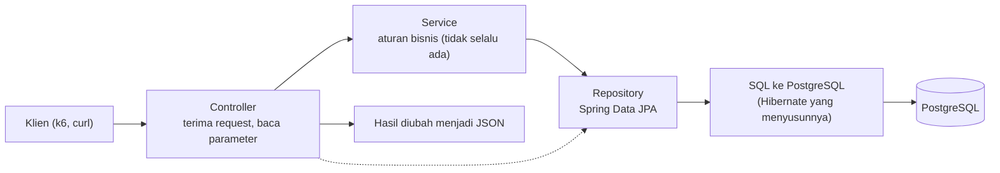

# Bagian 8: Contoh pengerjaan tiket

*Satu tiket dari Issue sampai laporan, dan cara membaca kodenya*

> **Tujuan.** Melihat satu tiket dikerjakan dari awal sampai akhir, lalu memakai langkah yang sama pada tiket latihanmu.  
> **Prasyarat.** Bagian 3 dan 4. Lab 0 sudah kamu jalankan, jadi `task up`, `task seed`, `task app`, dan k6 sudah pernah berhasil.  
> **Setelah bagian ini kamu bisa:**
> - mengikuti lima langkah kerja satu tiket dalam urutan yang sama setiap kali
> - menelusuri satu request dari controller sampai SQL, termasuk membaca kodenya
> - menulis laporan yang memisahkan fakta, dugaan, dan hal yang belum kamu ketahui
> - memperkirakan berapa lama satu tiket wajar dikerjakan

---

## 8.1 Lima langkah untuk setiap tiket

Instruksi tiket tersebar di beberapa berkas. Pegang urutan ini dan buka berkas lain hanya saat langkahnya membutuhkan.

| # | Langkah | Hasil | Berkas atau bagian yang dibuka |
| --- | --- | --- | --- |
| 1 | **Daftarkan tiket** sebagai Issue dengan kata-katamu sendiri, beri penanggung jawab | Issue di repo kelompok | `docs/PANDUAN-TIKET.md`, templat "Tiket kerja" |
| 2 | **Ukur gejalanya**: apa yang lambat, seberapa, untuk siapa | Angka dari k6, minimal satu sumber lain | Bagian 4, `labs/latihan/LAB.md` |
| 3 | **Telusuri jalurnya di kode**: request lewat kelas apa, SQL apa yang keluar | Daftar kelas dan SQL yang kamu baca | 8.2 dan 8.3 di bawah |
| 4 | **Tulis hipotesis**: satu atau dua dugaan, tandai "belum terbukti" | Dugaan yang bisa diuji | Bagian 6.1 |
| 5 | **Tulis laporan** dan lampirkan bukti ke PR | `labs/latihan/LAPORAN-<nomor>.md` | `labs/latihan/LAPORAN.md`, bagian 7 |

Dua hal yang sering terlewat:

- **Langkah 3 bukan pilihan.** Angka menunjukkan *bahwa* sesuatu lambat. Hanya kode dan SQL yang menunjukkan *kenapa*. Laporan yang hanya berisi pengukuran biasanya berhenti di "database sibuk" atau "aplikasi lambat".
- **Jangan memperbaiki apa pun.** Tugasmu memahami dan membuktikan, bukan mengubah kode.

Perkiraan waktu per tiket: **sekitar 90 menit** untuk orang yang sudah menjalankan Lab 0 (15 menit Issue dan memahami gejala, 30 menit mengukur, 30 menit membaca kode dan SQL, 15 menit menulis laporan). Kalau satu langkah memakan lebih dari dua kali perkiraan itu, tanyakan ke rekan atau pengajar, jangan diam. Dua tiket yang dipahami lebih baik daripada lima tiket yang dikerjakan tergesa.

---

## 8.2 Jalur satu request

Hampir semua endpoint PasarKita punya bentuk yang sama:



Tiga hal yang perlu kamu tahu sebelum membaca kode:

1. **Kamu tidak menulis SQL, tetapi SQL tetap ada.** Nama method seperti `findBySellerIdOrderByIssuedAtDesc` diterjemahkan menjadi SQL. Tugasmu melihat SQL yang benar-benar keluar (lihat 8.3).
2. **Relasi antar entity ikut dimuat.** Anotasi seperti `@ManyToOne` menentukan *kapan* data terkait diambil. Satu baris yang dikembalikan bisa membuat query tambahan.
3. **`@Transactional` memegang koneksi database** dari awal sampai akhir method. Apa pun yang dikerjakan di dalamnya, termasuk menunggu layanan luar, ikut menahan koneksi itu.

### Peta endpoint

| Endpoint | Controller | Kelas terkait |
| --- | --- | --- |
| `GET /api/sellers/{id}/profile` | `catalog/SellerProfileController` | `FeatureFlags`, `ThumbnailService`, `ProductRepository` |
| `GET /api/products`, `/search`, `/{id}` | `catalog/CatalogController` | `Product`, `Seller`, `ProductRepository` |
| `POST /api/auth/login` | `customer/AuthController` | `CustomerRepository`, `PasswordConfig`, `Customer` |
| `GET /api/sellers/{id}/invoices` | `invoice/InvoiceController` | `InvoiceService`, `InvoiceRepository`, `Invoice` |
| `GET /api/admin/orders` | `order/AdminOrderController` | `OrderRepository`, `Order`, `OrderLine` |
| `POST /api/cart/items` | `order/CartController` | `CartItem`, `CartItemRepository` |
| `POST /api/checkout` | `order/CheckoutController` | `CheckoutService`, `PricingService`, `TaxClient`, `PaymentService`, `PaymentGatewayClient`, `InventoryService`, `NotificationService` |

Skema tabel dan indeks ada di `src/main/resources/db/migration/V1__skema_awal.sql`.

---

## 8.3 Cara membaca kode untuk satu tiket

Buka controller endpoint-nya, lalu jawab empat pertanyaan ini sambil membaca. Catat jawabannya di laporan.

1. **Apa yang masuk?** Parameter apa yang dibaca, dan apa yang membatasinya?
2. **Siapa yang dipanggil?** Repository atau service apa, dan berapa kali dalam satu request?
3. **SQL apa yang keluar?** Jangan ditebak dari nama method. Jalankan request, lalu lihat `pg_stat_statements`:

   ```bash
   # nolkan statistik, kirim satu request, lihat query yang keluar
   task native:psql          # atau: docker compose exec postgres psql -U pasarkita
   ```

   ```sql
   select pg_stat_statements_reset();
   -- kirim satu request dari terminal lain
   select calls, round(mean_exec_time::numeric,3) as mean_ms,
          left(regexp_replace(query,'\s+',' ','g'),120) as query
   from pg_stat_statements
   where query not ilike '%pg_stat_statements%' and query !~* '^(BEGIN|COMMIT)'
   order by calls desc;
   ```

   Satu request, berapa baris hasilnya? Itulah jumlah query per request.
4. **Apa yang dikembalikan?** Entity langsung, atau objek khusus? Apa saja yang ikut diubah menjadi JSON?

Bandingkan jawabannya dengan angka dari k6. Jika dua sumber itu tidak cocok, di situlah bahan hipotesismu.

> Cek diri: sebuah request menghasilkan 21 query dan latensinya tetap 11 ms. Apakah itu berarti endpoint ini sehat? Apa yang akan terjadi bila lajunya naik sepuluh kali lipat?

---

## 8.4 Contoh lengkap: tiket #4800

Contoh ini memakai endpoint yang **tidak** termasuk tiket latihan, supaya kamu bisa meniru caranya tanpa mendapat jawaban tiketmu. Angkanya diukur di laptop pengajar dengan data skala S (5.000 produk), laju 20 request per detik, 30 detik. Angkamu akan berbeda, dan itu wajar.

### Langkah 1: tiket dan Issue

**Tiket #4800: Halaman detail produk, apakah aman dibuka banyak orang?**

> Dari: Tim Produk. Kami akan mempromosikan beberapa produk dan memperkirakan halaman detail produk (`GET /api/products/{id}`) dibuka lebih banyak. Belum ada keluhan. Tolong pastikan halaman ini tidak akan jadi masalah, dan beri tahu kalau ada yang perlu diperhatikan.

Issue yang didaftarkan anggota (kata-kata sendiri, bukan salinan tiket):

```markdown
Judul: Detail produk: periksa apakah siap untuk lonjakan kunjungan

Latar: Tim Produk akan promosi dan mengira halaman detail produk lebih ramai.
Yang perlu dijawab: berapa latensinya, berapa query per request, dan apakah ada yang perlu dikhawatirkan.
Penanggung jawab: @nama-anggota
Batas: hanya diamati, tidak mengubah kode.
```

### Langkah 2: ukur

Satu request dulu, untuk melihat bentuk responsnya:

```bash
curl -s localhost:8080/api/products/101
# {"id":101,"seller":{"id":102,"name":"Toko 102","city":"Bandung"},"sku":"SKU-0000101", ...}
curl -s -o /dev/null -w "%{http_code}\n" localhost:8080/api/products/99999999
# 404
```

Lalu beban singkat dengan k6 (id acak 1 sampai 5000, 20 req/detik, 30 detik):

```text
http_req_duration: med=5,64ms  p(95)=9,34ms  max=15,68ms
http_reqs:         601        (20,02/detik)
checks:            100% berhasil (601 dari 601)
```

Fakta sejauh ini: tidak ada error, p95 di bawah 10 ms. Belum ada alasan khawatir, tetapi angka ini belum menjelaskan apa-apa tentang *kenapa*.

### Langkah 3: telusuri di kode

`CatalogController.detail` hanya memanggil `products.findById(id)` dan melempar 404 bila kosong. Tidak ada service. Pertanyaan 4 dari 8.3: yang dikembalikan adalah `Product`, dan di dalamnya ada `seller`, jadi `Seller` ikut menjadi JSON (terlihat di respons `curl` tadi).

Sekarang pertanyaan 3: SQL apa yang keluar? Nolkan `pg_stat_statements`, jalankan k6, lalu lihat:

```text
calls | mean_ms | query
601   | 0,159   | select p1_0.id, p1_0.description, p1_0.name, p1_0.price, s1_0.id, s1_0.city, s1_0.name, p1_0.sku
                  from product p1_0 left join seller s1_0 on s1_0.id = p1_0.seller_id where p1_0.id = $1
```

601 request menghasilkan 601 panggilan: **satu query per request**, dengan `JOIN` ke `seller` di dalamnya. Rata-rata 0,159 ms di database, jauh di bawah p50 aplikasi sebesar 5,64 ms. Berarti sebagian besar waktu ada di luar database: aplikasi, serialisasi JSON, jaringan lokal. Itu hipotesis yang masih perlu dibuktikan, bukan fakta.

### Langkah 4: hipotesis

1. *(belum terbukti)* Detail produk murah karena Hibernate mengambil produk dan penjualnya dalam satu query `JOIN`, dan pencarian memakai primary key.
2. *(belum terbukti)* Selisih antara 0,159 ms (database) dan 5,64 ms (p50) terutama waktu aplikasi dan serialisasi; tidak diuji dengan trace.

### Langkah 5: laporan (bentuk ringkas)

```markdown
# Laporan tiket #4800: Detail produk

## Gejala
Tidak ada keluhan. Pertanyaan: siap untuk lonjakan kunjungan?

## Reproduksi
k6, GET /api/products/{id} id acak 1..5000, 20 req/detik, 30 detik, skala S, laptop pengajar.
Perintah: k6 run detail.k6.js

## Bukti
1. k6: p50 5,64 ms, p95 9,34 ms, max 15,68 ms, 601 request, 0 error.
2. pg_stat_statements: 601 panggilan untuk 601 request (1 query per request), rata-rata 0,159 ms.
3. Kode: CatalogController.detail -> ProductRepository.findById; Product.seller dimuat lewat JOIN.
4. id yang tidak ada dijawab 404.

## Hipotesis
1. (belum terbukti) murah karena 1 query JOIN lewat primary key.
2. (belum terbukti) sisa ~5 ms ada di aplikasi/serialisasi.

## Yang diabaikan
Peringatan "legacy.timeout is deprecated" tiap 30 detik: berjalan terpisah, tidak terkait.

## Langkah berikutnya
Ulangi pada skala M dan laju lebih tinggi; ambil trace untuk membuktikan hipotesis 2.

## Keterbatasan
Skala S saja (5.000 produk), satu mesin, satu laju, id acak merata sehingga cache database
cenderung hangat. Hanya jalur sukses yang diukur.
```

Perhatikan apa yang membuat laporan ini layak:

- Fakta ada di bagian **Bukti**, dugaan ada di **Hipotesis** dan ditandai.
- Ada kalimat tentang apa yang **tidak diketahui** dan **tidak diukur**.
- Tidak ada kata "pasti". Tidak ada saran memperbaiki.
- Kesimpulannya "tidak ada yang mengkhawatirkan dalam kondisi ini", dan itu hasil yang sah.

### Yang akan kamu lakukan berbeda

Tiket latihanmu punya gejala. Karena itu langkah 2 dan 3 akan saling menarik: angka k6 menunjuk ke arah tertentu, kode dan SQL menunjukkan kenapa. Cara membandingkan dua jalur yang mirip (misalnya detail satu produk dengan daftar banyak produk) sering membuka hal yang tidak kelihatan dari satu endpoint saja. Mencobanya adalah bagian dari latihanmu.

---

## 8.5 Mulai membaca dari mana, per tiket

Daftar ini hanya menunjukkan **berkas yang perlu dibaca dan satu pertanyaan penuntun**. Penyebabnya ada di kamu.

| Tiket | Mulai baca dari | Pertanyaan penuntun |
| --- | --- | --- |
| #4821 profil toko | `SellerProfileController`, `FeatureFlags`, `ThumbnailService` | Apa yang berbeda bila kondisi tertentu aktif? Dikerjakan untuk setiap apa? |
| #4822 pesanan admin | `AdminOrderController`, `Order`, `OrderLine`, `OrderRepository` | Apa saja yang ikut menjadi JSON, dan kapan data itu diambil dari database? |
| #4823 login | `AuthController`, `CustomerRepository`, `PasswordConfig`, `V1__skema_awal.sql` | SQL apa yang dibentuk dari nama method itu, dan indeks apa yang tersedia untuknya? |
| #4824 invoice penjual | `InvoiceController`, `InvoiceService`, `InvoiceRepository`, `V1__skema_awal.sql` | Indeks apa yang ada, dan apa yang diminta urutan hasilnya? Apakah semua penjual sama? |
| #4825 katalog | `CatalogController`, `Product`, `Seller`, `ProductRepository` | Apa yang terjadi pada relasi `seller` untuk setiap baris produk dalam satu halaman? |
| #4826 pencarian | `CatalogController.search`, `ProductRepository` (anotasi `@Query`) | Seperti apa pola pencariannya, dan indeks apa yang bisa membantunya? Bagaimana dengan total hasil? |
| #4827 checkout | `CheckoutController`, `CheckoutService`, `PricingService`, `TaxClient`, `PaymentGatewayClient`, `NotificationService` | Apa yang dipanggil di dalam method bertanda `@Transactional`, dan berapa kali? |
| #4828 halaman besar | `AdminOrderController`, `Order` | Apa yang membatasi ukuran halaman? Bagaimana biayanya berubah bila ukurannya digandakan? |
| #4829 keranjang | `CartController`, `CartItem`, `CheckoutService`, `InventoryService`, `PaymentService` | Apa yang diperiksa sebelum data disimpan? Apa yang terjadi di checkout bila isinya aneh? |
| #4830 input salah | Semua controller berhalaman, `AuthController` | Apa jawaban sistem bila parameter, tipe, atau badan permintaan salah? Apakah konsisten? |
| #4831 integrasi | Laporan rekanmu | Pola apa yang muncul di beberapa tiket? Mana yang prioritas, dan menurut kriteria apa? |

---

## 8.6 Jika kamu macet

- **Tidak tahu harus mulai dari mana:** kembali ke tabel 8.1, kerjakan langkah yang paling kecil.
- **Angka tidak cocok dengan rekan:** itu wajar (mesin, laju, dan data berbeda). Catat spesifikasi mesinmu di laporan.
- **Kode terasa terlalu banyak:** buka hanya controller dan satu repository. Satu kelas dipahami dulu, baru yang berikutnya.
- **Tidak bisa menjelaskan sendiri hasilnya:** jelaskan ke rekan dengan bukti (bagian 6.1.9). Menjelaskan ke orang lain sering lebih cepat dari membaca ulang.
- **Sudah melewati dua kali perkiraan waktu:** tanya pengajar atau rekan dengan menyertakan apa yang sudah kamu coba.

> Cek diri: laporanmu berisi grafik yang jelas dan angka yang rapi, tetapi tidak ada satu pun kelas yang kamu sebutkan. Apa yang belum bisa kamu jelaskan?

---

*Sebelumnya: [Bagian 7](07-menyerahkan-hasil.md) · [Daftar isi](../MATERI-DASAR.md) · Berikutnya: [Bagian 9](09-dari-diagnosis-ke-perbaikan.md)*
